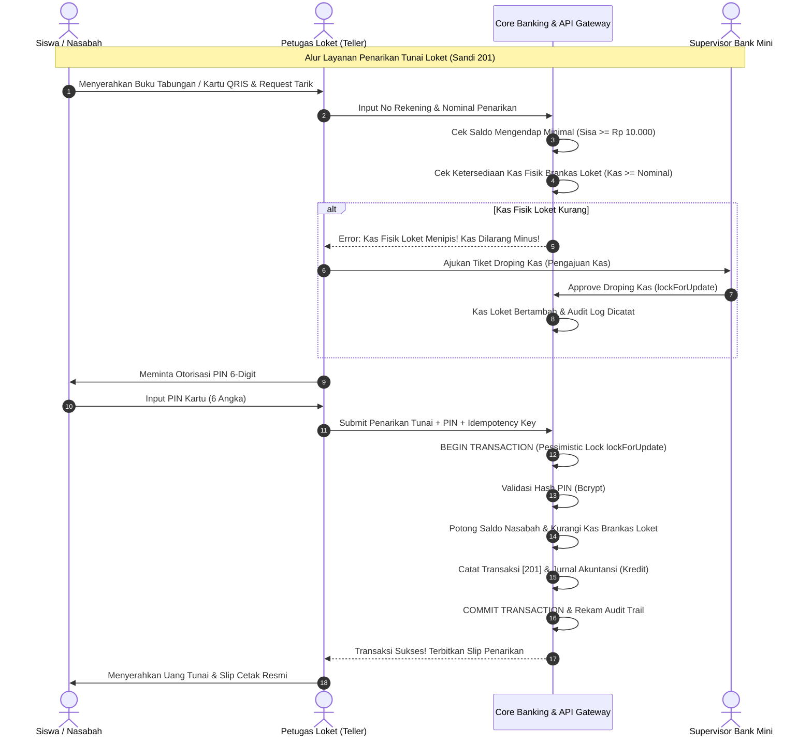
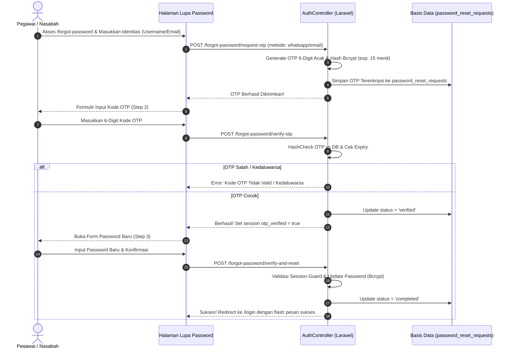
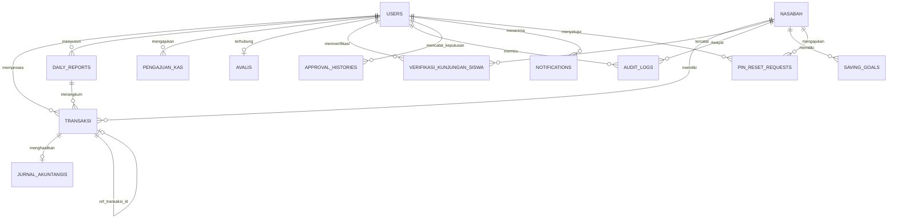

# Product Requirement Document (PRD)
# Sistem Informasi Bank Mini Sekolah Enterprise
### *Full-Stack Omnichannel Core Micro-Banking, Accounting Ledger, Teller POS & Mobile Student Banking System*

---

## 1. Dokumen Kontrol & Identitas Proyek

| Atribut | Informasi Terkini |
|---|---|
| **Nama Produk** | Sistem Bank Mini Sekolah (*School Core Micro-Banking & Omnichannel Ecosystem*) |
| **Kode Proyek** | `BANKMINI-CBS-2026` |
| **Versi Dokumen** | `v2.7.0 (Cloud Production Deployment, CI/CD Auto-Deploy, Public Portal & OTP Security Release)` |
| **Status Dokumen** | **Approved / Production-Live / Cloud-Verified** |
| **Target Implementasi** | Laboratorium Perbankan Mini SMK (Jurusan Akuntansi & Keuangan Lembaga / Rekayasa Perangkat Lunak) & Standar Uji Kompetensi Keahlian (UKK Nasional) |
| **Production URL** | `https://hanbank.my.id` (Live Cloud Hosting DomaiNesia) |
| **Stack Backend** | PHP 8.4.27, Laravel 13.x, MySQL 8.4 / MariaDB InnoDB, Laravel Sanctum v4, Tailwind CSS, Vite 8, PHP GD Engine |
| **Stack Mobile** | Flutter 3.x, Dart 3.x, Dio v5.11, MobileScanner v7.4, FL Chart v0.70, QR Flutter, SharedPreferences |
| **Infrastruktur & CI/CD** | Cloud Shared Hosting (cPanel DomaiNesia), GitHub Actions Auto-Deploy FTPS Pipeline, Multi-Environment Kernel (`public/index.php`) |
| **Hasil Verifikasi Uji** | **Backend Core Tests: Passed (Zero Critical Bugs)**<br>**Mobile Flutter: 31 Tests (100% Lolos)** |
| **Tanggal Pembaruan** | 7 November 2026 |

---

## 2. Ringkasan Eksekutif & Latar Belakang

### 2.1 Konteks Proyek
Di era transformasi digital pendidikan vokasi, institusi Sekolah Menengah Kejuruan (SMK) membutuhkan sarana pembelajaran riil yang merefleksikan alur kerja industri perbankan komersial sesungguhnya. **Sistem Bank Mini Sekolah** dikembangkan sebagai aplikasi perbankan mikro terpadu (*Core Banking System*) yang memfasilitasi transaksi tabungan siswa nyata di sekolah sekaligus menjadi simulator operasional perbankan berstandar akuntansi nasional.

Sistem ini mengintegrasikan seluruh ekosistem perbankan sekolah dalam satu kesatuan omnichannel:
1. **Portal Publik & Landing Page Interaktif (`/` dan `/download`)**: 
   - Halaman depan modern (*Modern Hero Section*) dengan showcase mockup smartphone 3D interaktif yang menampilkan antarmuka *HanBank Mobile*.
   - Informasi profil bank mini sekolah, katalog produk tabungan mikro, section FAQ interaktif, serta portal resmi pengunduhan APK Android (*Mobile App Download Hub*).
   - Navigasi responsif yang terhubung langsung ke pintu masuk otentikasi back-office.
2. **Portal Web Operasional Back-Office & Loket**: Digunakan oleh Administrator Utama, Supervisor (Kepala Bank Mini), Petugas Teller Loket, dan Petugas Avalis (siswa piket jaga).
3. **Aplikasi Native Mobile Multi-Role (Flutter)**: 
   - **Nasabah / Siswa**: Monitoring saldo tabungan, kartu identitas QRIS digital, buku mutasi, grafik analitik keuangan, target menabung (*saving goals*), gamifikasi pencapaian (*badges*), log aktivitas sesi, dan fitur blokir rekening mandiri (*emergency freeze*).
   - **Teller Loket (Mobile POS)**: Pemindai QRIS/Barcode nasabah, formulir setor tunai cepat, formulir penarikan tunai aman dengan validasi PIN & kas brankas, pengajuan droping kas, dan penyusunan laporan kas penutupan harian (*daily report*).
   - **Supervisor (Approval Center)**: Pusat persetujuan droping kas loket dengan mekanisme *pessimistic locking*, verifikasi lembar kas harian teller, monitoring transaksi kasir real-time, rekonsiliasi kas otomatis, dan penerimaan notifikasi operasional.
   - **Administrator (System Health & Directory)**: Pemantauan kesehatan server, latensi koneksi basis data, status direktori pengguna RBAC, dan agregasi saldo tabungan per program keahlian/jurusan.
4. **RESTful API Gateway Berbasis Token (Laravel Sanctum)**: Menyediakan **54 endpoint** berkinerja tinggi yang menghubungkan klien web dan aplikasi mobile secara aman dengan dukungan autentikasi universal (*Universal Auth*).
5. **Infrastruktur Cloud Live Production (`hanbank.my.id`)**: Dilengkapi pipeline CI/CD GitHub Actions otomatis yang menyinkronkan kode ke server hosting DomaiNesia setiap kali terjadi *push* ke branch `main`.

### 2.2 Masalah yang Diselesaikan (Problem Statement)
1. **Pencatatan Konvensional yang Rentan Human-Error**: Pencatatan tabungan manual menggunakan buku kas fisik sering menimbulkan selisih kas (*discrepancy*), manipulasi saldo, dan hilangnya rekaman historis.
2. **Ketiadaan Prinsip *Maker-Checker* Perbankan**: Sistem konvensional tidak memiliki kontrol berjenjang, sehingga teller dapat melakukan transaksi tanpa otorisasi atau validasi ketersediaan kas.
3. **Risiko Kas Minus (*Negative Cash Till*)**: Ketiadaan sinkronisasi brankas fisik dapat menyebabkan pengeluaran kas melebihi ketersediaan uang di laci teller.
4. **Pembukuan Akuntansi Terpisah**: Banyak aplikasi tabungan sekolah hanya mencatat mutasi nasabah tanpa menghasilkan buku jurnal akuntansi berpasangan (*double-entry bookkeeping*) untuk neraca dan laporan keuangan.
5. **Keterbatasan Akses Siswa**: Siswa tidak dapat memantau saldo tabungan, riwayat transaksi, atau menumbuhkan motivasi menabung secara terstruktur di lingkungan sekolah.
6. **Keamanan Pemulihan Kredensial**: Menggantikan mekanisme reset password manual yang rawan penipuan dengan verifikasi OTP 6-digit terenkripsi bcrypt dan persetujuan tiket admin berjenjang.
7. **Pencegahan Risiko Transaksi Liar Antar-Pelajar**: Menghindari potensi penyalahgunaan transfer digital mandiri yang rawan pemerasan atau perundungan (*bullying*) di kalangan siswa, sehingga arus kas tabungan sekolah dipusatkan secara akuntabel melalui loket resmi teller.

### 2.3 Tujuan Utama Produk (Product Goals)
- **Zero Cash Discrepancy**: Menjamin sinkronisasi 100% antara saldo fisik uang di brankas/loket dengan mutasi digital di sistem.
- **Standar Akuntansi Perbankan**: Otomatisasi jurnal umum debit/kredit setiap kali transaksi setoran, penarikan, pemotongan admin, atau pembatalan (*void*) terjadi.
- **Keamanan Finansial Berlapis**: Penerapan otorisasi PIN kartu 6-digit, batas saldo minimal mengendap (Rp 10.000), pencegahan kas minus secara absolut, verifikasi OTP pemulihan kata sandi, sanitasi berkas profil anti-malware 5 lapis, serta pencegahan eksekusi ganda (*idempotency protection*).
- **Gamifikasi Literasi Finansial**: Menanamkan kebiasaan hidup hemat bagi pelajar melalui fitur *Saving Goals* dan lencana pencapaian (*Badges*).
- **Kesiapan Uji Kompetensi Keahlian (UKK) & Akses Cloud Global**: Dapat diakses secara lokal dalam jaringan laboratorium sekolah maupun diakses publik secara aman via domain resmi `https://hanbank.my.id`.

---

## 3. Analisis Pengguna & Matriks Hak Akses (RBAC & SoD)

```mermaid
flowchart TD
    subgraph Pengguna Sistem (Omnichannel)
        G["0. Publik / Siswa Umum"]
        A["1. Administrator Utama"]
        B["2. Supervisor / Kepala Bank Mini"]
        C["3. Petugas Loket (Teller)"]
        D["4. Petugas Avalis (Piket Jaga Siswa)"]
        E["5. Nasabah (Siswa Penabung)"]
    end

    subgraph Modul Operasional & Wewenang
        M0["Landing Page Showcase, Info Tabungan, Unduh APK Mobile Android"]
        M1["Kelola Akun, Impor CSV, Audit Trail Log, Konfigurasi Sistem, Approval Reset Password & PIN"]
        M2["Approval Center Droping Kas, Verifikasi Daily Report, Monitoring Teller, Rekonsiliasi Kas, Laporan Akuntansi"]
        M3["Setoran [101], Penarikan [201], Void Transaksi, Cetak Slip, Pengajuan Kas, Input Daily Report"]
        M4["Presensi Shift Loket (Pagi/Siang), Scan Verifikasi Kunjungan Siswa"]
        M5["Cek Saldo, Kartu QRIS, Mutasi, Saving Goals, Gamifikasi Badges, Self Freeze, Session Log"]
    end

    G --> M0
    A --> M1
    B --> M2
    C --> M3
    D --> M4
    E --> M5
```

### 3.1 Profil Pengguna (User Personas)

#### 0. Publik & Siswa Umum (`guest`)
- Mengakses halaman muka umum di `https://hanbank.my.id/`.
- Membaca deskripsi layanan Bank Mini Sekolah (Tabungan Siswa, Pembayaran Biaya, Laporan Keuangan).
- Mengunduh berkas APK aplikasi mobile Android versi terbaru di `/download`.
- Mengakses pintu masuk login sistem petugas atau pemulihan sandi mandiri via OTP.

#### 1. Administrator Utama (`role: admin`)
- **Tanggung Jawab**: Pengawas infrastruktur sistem, penanggung jawab tata kelola akun pegawai (Teller, Supervisor), pemelihara basis data nasabah, dan pelaksana konfigurasi global.
- **Aktivitas Harian**:
  - Menambah, mengedit, memulihkan data (*restore soft delete*), atau menonaktifkan akun pegawai sistem dan nasabah.
  - Impor data siswa penabung secara massal melalui berkas CSV.
  - Mengubah konfigurasi batas saldo mengendap minimal dan identitas sekolah.
  - Menyetujui atau menolak tiket *reset password* pegawai dan permohonan *reset PIN* nasabah siswa.
  - Memantau rekam jejak audit (*audit trail log*) yang telah disanitasi dari data sensitif dan ekspor log ke CSV.

#### 2. Supervisor / Kepala Bank Mini (`role: supervisor`, `accounting`)
- **Tanggung Jawab**: Pejabat otorisasi (*Checker & Approver*) tingkat tinggi yang memantau integritas kas besar (*vault*), keabsahan laporan teller, dan kepatuhan akuntansi.
- **Aktivitas Harian**:
  - Memeriksa antrean permohonan dana (*Pengajuan Kas Droping*) dari teller di Approval Center dan memberikan keputusan (Setujui / Tolak dengan catatan wajib / Tahan / Hold).
  - Memvalidasi, memverifikasi, atau meminta revisi atas *Daily Report* harian dari masing-masing loket teller.
  - Memantau produktivitas transaksi teller (memisahkan volume transaksi sukses dan void).
  - Melakukan rekonsiliasi kas otomatis (mengecek selisih antara kas fisik dan sistem).
  - Menginspeksi laporan jurnal akuntansi, saldo simpanan per produk, dan laporan laba/rugi tahunan.

#### 3. Petugas Loket Teller (`role: teller`)
- **Tanggung Jawab**: Pelaksana transaksi operasional di loket (*Maker*), melayani setoran tunai, penarikan tunai, dan rekonsiliasi kas loket harian.
- **Aktivitas Harian**:
  - Menginput saldo awal operasional kas teller hari ini.
  - Melayani setoran tunai siswa (Kode Sandi 101) dan menerbitkan slip setoran resmi.
  - Melayani penarikan tunai siswa (Kode Sandi 201) dengan verifikasi PIN 6-digit, validasi saldo mengendap, dan ketersediaan uang di kas loket.
  - Melakukan pembatalan (*void*) transaksi jika terjadi kesalahan input atau penemuan uang palsu/rusak dengan mutasi jurnal pembalik otomatis.
  - Mengajukan permohonan kas tambahan (*droping kas*) ke Supervisor jika uang fisik di loket menipis.
  - Menyusun *Daily Report* (Laporan Kas Harian) pada akhir jam layanan loket untuk diserahkan ke Supervisor.

#### 4. Petugas Avalis Loket (Siswa Bertugas)
- **Tanggung Jawab**: Siswa jurusan Akuntansi yang ditugaskan piket shift loket bank mini untuk melatih kemampuan pelayanan perbankan nyata.
- **Aktivitas Harian**:
  - Melakukan presensi kehadiran kerja loket (Shift Pagi: 07.30 - 11.30 WIB atau Shift Siang: 11.30 - 15.30 WIB).
  - Menampilkan foto profil resmi berstatus aktif di lembar daftar hadir loket lengkap dengan indikator kehadiran dan modal pratinjau.
  - Melakukan verifikasi fisik kunjungan siswa ke loket melalui pemindaian QRIS / Barcode NIS.

#### 5. Nasabah / Siswa Penabung (`role: nasabah`)
- **Tanggung Jawab**: Pemilik rekening tabungan simpanan pelajar.
- **Aktivitas Harian**:
  - Mengakses aplikasi *Mobile Banking* untuk memantau saldo tabungan secara riil (total saldo, saldo tersedia, saldo mengendap).
  - Menampilkan kartu identitas tabungan digital berbasis QRIS untuk transaksi cepat di loket teller.
  - Mengatur dan memantau target menabung (*Saving Goals*).
  - Memantau pencapaian lencana literasi keuangan (*Badges & Gamification*).
  - Mengajukan tiket ganti PIN mandiri jika lupa PIN kartu tabungan.
  - Mengelola keamanan akun: ganti kata sandi, ubah PIN 6-digit, melihat riwayat sesi login, serta memblokir sementara rekening secara mandiri jika kartu/HP hilang.

### 3.2 Matriks Pemisahan Wewenang (Separation of Duties - SoD)

| Wewenang / Aksi Operasional | Publik | Admin | Supervisor | Teller | Avalis | Nasabah |
|---|:---:|:---:|:---:|:---:|:---:|:---:|
| Akses Landing Page & Unduh APK | **Ya** | **Ya** | **Ya** | **Ya** | **Ya** | **Ya** |
| Manajemen Akun Pegawai & Role | Tidak | **Ya** | Tidak | Tidak | Tidak | Tidak |
| Impor Data & Cetak Kartu Nasabah | Tidak | **Ya** | Lihat | Tidak | Tidak | Tidak |
| Soft Delete & Restore Data Nasabah | Tidak | **Ya** | Tidak | Tidak | Tidak | Tidak |
| Approval Tiket Reset PIN & Password | Tidak | **Ya** | Tidak | Tidak | Tidak | Tidak |
| Eksekusi Setor Tunai [101] & Tarik Tunai [201] | Tidak | Tidak | Tidak | **Ya** | Tidak | Tidak |
| Eksekusi Void / Pembatalan Transaksi | Tidak | Tidak | Tidak | **Ya** (Logged) | Tidak | Tidak |
| Ajukan Tiket Droping Kas Operasional | Tidak | Tidak | Tidak | **Ya** | Tidak | Tidak |
| Otorisasi / Setujui Droping Kas (*Checker*) | Tidak | Tidak | **Ya** | Dilarang | Tidak | Tidak |
| Submit Penutupan Kas Harian (*Daily Report*) | Tidak | Tidak | Tidak | **Ya** | Tidak | Tidak |
| Verifikasi / Validasi *Daily Report* Teller | Tidak | Tidak | **Ya** | Dilarang | Tidak | Tidak |
| Monitoring Kas Brankas & Rekonsiliasi Otomatis | Tidak | Lihat | **Ya** | Tidak | Tidak | Tidak |
| Presensi Shift Jaga Loket & Scan Kunjungan | Tidak | Kelola | Monitoring | Presensi | **Ya** | Tidak |
| Akses Mobile Banking Siswa (Goals, Badges) | Tidak | Tidak | Tidak | Tidak | Tidak | **Ya** |

---

## 4. Standar Operasional Prosedur (SOP) & Alur Bisnis

### 4.1 SOP Layanan Penarikan Tunai Loket (Sandi 201)


### 4.2 SOP Pemulihan Kata Sandi Mandiri Berbasis OTP


### 4.3 Ringkasan SOP Operasional Lainnya
- **SOP-01 (Pembukaan Rekening)**: Administrator mendaftarkan siswa, membuat nomor rekening unik urut `202601xxx`, mengaktifkan akun dengan saldo awal Rp 0, dan PIN default `123456`.
- **SOP-02 (Setoran Tunai Loket Sandi 101)**: Teller menerima uang fisik, sistem menambah saldo nasabah, mencatat mutasi [101], menambah fisik kas brankas, dan menerbitkan slip setoran cetak.
- **SOP-04 (Void Transaksi)**: Pembatalan transaksi salah input oleh teller sebelum penutupan kas dengan mutasi pembalik otomatis dan audit log *non-destructive*.
- **SOP-05 (Maker-Checker Droping Kas)**: Teller mengajukan tiket droping kas jika uang fisik di laci menipis; Supervisor memeriksa ketersediaan brankas utama dan menyetujui menggunakan *pessimistic lock*.
- **SOP-06 (Daily Report & Rekonsiliasi)**: Penutupan kas harian akhir sesi loket, pencocokan fisik uang tunai (*cash count*) dengan catatan sistem, dan verifikasi oleh Supervisor (*zero variance*).
- **SOP-07 (Presensi Avalis)**: Presensi shift loket siswa piket dengan integrasi avatar foto resmi dan status kehadiran.
- **SOP-08 (Verifikasi Kunjungan Siswa)**: Pemindaian barcode NIS/QRIS kartu siswa di loket untuk mencatat keaktifan literasi menabung.

---

## 5. Arsitektur Perangkat Lunak & Infrastruktur Cloud

### 5.1 Diagram Arsitektur Cloud & CI/CD Pipeline

```mermaid
graph TB
    subgraph Development Layer (Local)
        DevMachine["Laptop Pengembang (Localhost:8000)"]
        GitRepo["GitHub Repository (YoshikazuX/UKK_BankMini)"]
    end

    subgraph CI_CD Pipeline (GitHub Actions)
        Runner["Ubuntu Runner (deploy.yml)"]
        PHPSetup["Setup PHP 8.4 + Extensions"]
        ComposerJob["Composer Install --no-dev & Optimize"]
        ViteJob["Node 22 + NPM Run Build"]
        CacheJob["Artisan route:cache & view:cache"]
        FTPDeploy["FTP-Deploy-Action (FTPS Secure Upload)"]
    end

    subgraph Production Cloud Layer (DomaiNesia cPanel)
        Domain["https://hanbank.my.id"]
        WebRoot["/home/hanbankm/public_html (Public Assets, index.php)"]
        AppCore["/home/hanbankm/hanbank_app (Core Laravel, Vendor, Storage)"]
        ProdDB[("MySQL 8.4 Database: hanbankm_bankmini_prod")]
    end

    DevMachine -- "git push origin main" --> GitRepo
    GitRepo -- "trigger on push" --> Runner
    Runner --> PHPSetup --> ComposerJob --> ViteJob --> CacheJob --> FTPDeploy
    FTPDeploy -- "Upload /public" --> WebRoot
    FTPDeploy -- "Upload Core Files" --> AppCore
    Domain --> WebRoot
    WebRoot -- "Dynamic Bootstrap" --> AppCore
    AppCore --> ProdDB
```

### 5.2 Spesifikasi Teknologi & Lingkungan
- **Backend Runtime**: PHP 8.4.27 (Production & Local Development).
- **Backend Framework**: Laravel 13.x dengan arsitektur kernel *Dual-Environment* (`is_dir(__DIR__.'/../hanbank_app')`).
- **Cloud Hosting**: DomaiNesia Shared Hosting (Server: LiteSpeed / Apache, PHP 8.4 FPM, cPanel User: `hanbankm`).
- **Database Engine**: MySQL 8.4 / MariaDB 10.x InnoDB (Database: `hanbankm_bankmini_prod`, Enkoding: `utf8mb4_unicode_ci`).
- **Otomasi CI/CD**: GitHub Actions Workflow (`.github/workflows/deploy.yml`) dengan trigger otomatis saat ada push ke `main`.
- **Autentikasi Token API**: Laravel Sanctum v4 (Personal Access Token, Token Scopes).
- **Web Frontend**: Blade Templating + Tailwind CSS + Fallback CDN Engine + Vite 8 Asset Bundler.
- **Mobile Framework**: Flutter 3.x / Dart 3.x (Material 3 Responsive, Dio v5.11, FL Chart v0.70, MobileScanner v7.4).
- **Image Security Engine**: PHP GD Extension (Kanvas resintesis, sanitasi EXIF, deteksi polyglot script).

---

## 6. Arsitektur Basis Data Lengkap (18 Tabel)

Sistem menggunakan 18 tabel relasional yang saling terintegrasi:



### 6.1 Kamus Data Detail Seluruh 18 Tabel

#### 1. Tabel `users` (Akun Pegawai Bank Mini)
| Kolom | Tipe Data | Nullable | Keterangan & Aturan |
|---|---|---|---|
| `id` | BIGINT UNSIGNED | NO | Primary Key, Auto Increment |
| `username` | VARCHAR(100) | NO | Unique, kredensial login pegawai |
| `nama_petugas` | VARCHAR(150) | NO | Nama resmi petugas |
| `password` | VARCHAR(255) | NO | Hash bcrypt kata sandi |
| `role` | VARCHAR(50) | NO | Hak akses: `admin`, `supervisor`, `teller`, `accounting` |
| `status` | ENUM('aktif','nonaktif') | NO | Status operasional pegawai (Default: aktif) |
| `kelas` | VARCHAR(50) | YES | Divisi/Rombel (contoh: Staff Administrasi, XII AKL 1) |
| `no_hp` | VARCHAR(25) | YES | Kontak telepon seluler petugas |
| `email` | VARCHAR(150) | YES | Email resmi pegawai |
| `foto` | VARCHAR(255) | YES | Path berkas profil yang tersanitasi aman |
| `created_at` / `updated_at` | TIMESTAMP | YES | Timestamp standar |

#### 2. Tabel `nasabah` (Data Siswa Penabung - SoftDeletes)
| Kolom | Tipe Data | Nullable | Keterangan & Aturan |
|---|---|---|---|
| `id` | BIGINT UNSIGNED | NO | Primary Key, Auto Increment |
| `no_rekening` | VARCHAR(50) | NO | Unique, nomor rekening simpanan pelajar |
| `nis` | VARCHAR(50) | NO | Unique, Nomor Induk Siswa |
| `nama_siswa` | VARCHAR(150) | NO | Nama lengkap siswa penabung |
| `kelas` | VARCHAR(50) | NO | Rombongan belajar (contoh: XI RPL 1, XII AKL 2) |
| `jurusan` | VARCHAR(100) | NO | Program keahlian siswa |
| `email` | VARCHAR(150) | YES | Email nasabah siswa |
| `no_hp` | VARCHAR(25) | YES | Nomor WhatsApp/kontak siswa |
| `username` | VARCHAR(100) | YES | Kredensial login mobile nasabah |
| `password` | VARCHAR(255) | YES | Hash bcrypt kata sandi login mobile |
| `pin_keamanan` | VARCHAR(255) | YES | Hash bcrypt 6 digit PIN otorisasi kartu |
| `saldo` | DECIMAL(15,2) | NO | Saldo tabungan aktif (Default: 0.00) |
| `status` | ENUM('aktif','nonaktif') | NO | Status rekening (`aktif` atau `nonaktif` / diblokir mandiri) |
| `kategori` | ENUM('siswa','guru','alumni') | NO | Kategori nasabah (Default: siswa) |
| `deleted_at` | TIMESTAMP | YES | Waktu penghapusan lunak (*SoftDeletes*) |
| `created_at` / `updated_at` | TIMESTAMP | YES | Timestamp standar |

#### 3. Tabel `transaksi` (Buku Mutasi Transaksi Tabungan)
| Kolom | Tipe Data | Nullable | Keterangan & Aturan |
|---|---|---|---|
| `id` | BIGINT UNSIGNED | NO | Primary Key, Auto Increment |
| `nasabah_id` | BIGINT UNSIGNED | NO | FK ke `nasabah.id` |
| `petugas_id` | BIGINT UNSIGNED | YES | FK ke `users.id` (petugas pemproses) |
| `daily_report_id` | BIGINT UNSIGNED | YES | FK ke `daily_reports.id` |
| `jenis_transaksi` | VARCHAR(50) | NO | `setor`, `tarik`, `transfer_masuk`, `transfer_keluar`, `koreksi_setor`, `koreksi_tarik`, `admin` |
| `kode_sandi` | VARCHAR(10) | YES | Sandi perbankan: 101 (Setor), 201 (Tarik), 102 (Void Setor), 202 (Void Tarik), 301 (Admin) |
| `jenis_layanan` | VARCHAR(50) | YES | Produk tabungan (Tabungan Siswa, Qurban, Wisata) |
| `nominal` | DECIMAL(15,2) | NO | Besaran nominal transaksi |
| `nama_petugas` | VARCHAR(150) | YES | Snapshot nama teller yang bertugas |
| `status` | VARCHAR(50) | NO | Status: `sukses`, `pending`, `dibatalkan` |
| `idempotency_key` | VARCHAR(100) | YES | Token pencegahan eksekusi ganda klik tombol |
| `ref_transaksi_id` | BIGINT UNSIGNED | YES | FK ke `transaksi.id` (referensi transaksi yang dibatalkan / void) |
| `dibatalkan_oleh` | BIGINT UNSIGNED | YES | FK ke `users.id` (petugas yang mengeksekusi void) |
| `dibatalkan_at` | TIMESTAMP | YES | Jam dan tanggal eksekusi void |
| `alasan_batal` | TEXT | YES | Catatan resmi alasan koreksi/pembatalan transaksi |
| `created_at` / `updated_at` | TIMESTAMP | YES | Waktu transaksi |

#### 4. Tabel `brankas` (Posisi Kas Fisik Harian)
| Kolom | Tipe Data | Nullable | Keterangan & Aturan |
|---|---|---|---|
| `id` | BIGINT UNSIGNED | NO | Primary Key |
| `tanggal` | DATE | NO | Unique per tanggal operasional bank |
| `saldo_awal` | DECIMAL(15,2) | NO | Modal kas pembukaan loket hari ini |
| `masuk` | DECIMAL(15,2) | NO | Akumulasi penerimaan uang tunai loket hari ini |
| `keluar` | DECIMAL(15,2) | NO | Akumulasi pengeluaran uang tunai loket hari ini |
| `total` | DECIMAL(15,2) | NO | Sisa saldo fisik kas akhir hari berjalan (`saldo_awal + masuk - keluar`) |

#### 5. Tabel `jurnal_akuntansis` (Buku Besar Akuntansi)
| Kolom | Tipe Data | Nullable | Keterangan & Aturan |
|---|---|---|---|
| `id` | BIGINT UNSIGNED | NO | Primary Key |
| `transaksi_id` | BIGINT UNSIGNED | YES | FK ke `transaksi.id` |
| `tanggal` | DATE | NO | Tanggal pembukuan |
| `keterangan` | VARCHAR(255) | NO | Narasi entri debit/kredit |
| `debit` | DECIMAL(15,2) | NO | Mutasi debit kas |
| `kredit` | DECIMAL(15,2) | NO | Mutasi kredit kas |

#### 6. Tabel `daily_reports` (Laporan Kas Teller Harian)
| Kolom | Tipe Data | Nullable | Keterangan & Aturan |
|---|---|---|---|
| `id` | BIGINT UNSIGNED | NO | Primary Key |
| `user_id` | BIGINT UNSIGNED | NO | FK ke `users.id` (Teller pelapor) |
| `tanggal` | DATE | NO | Tanggal laporan harian |
| `saldo_awal` | DECIMAL(15,2) | NO | Modal kas pembukaan |
| `total_deposit` | DECIMAL(15,2) | NO | Total penerimaan setoran hari ini |
| `total_withdrawal` | DECIMAL(15,2) | NO | Total pengeluaran penarikan hari ini |
| `total_cash_drop` | BIGINT | NO | Total droping dana kas operasional yang diterima dari Supervisor |
| `saldo_akhir` | DECIMAL(15,2) | NO | Saldo fisik kas penutupan hasil cash-count |
| `status` | ENUM('draft','submitted','verified','rejected') | NO | Status verifikasi supervisor |
| `notes` | TEXT | YES | Catatan penutupan dari teller |
| `catatan_spv` | TEXT | YES | Catatan telaah dari supervisor |
| `alasan_penolakan` | TEXT | YES | Keterangan wajib jika laporan ditolak / diminta revisi |

#### 7. Tabel `pengajuan_kas` (Tiket Droping Kas Loket)
| Kolom | Tipe Data | Nullable | Keterangan & Aturan |
|---|---|---|---|
| `id` | BIGINT UNSIGNED | NO | Primary Key |
| `nomor_pengajuan` | VARCHAR(50) | NO | Kode tiket droping unik (contoh: `PK-20261031-001`) |
| `user_id` | BIGINT UNSIGNED | NO | FK ke `users.id` (Teller pemohon) |
| `tanggal` | DATE | NO | Tanggal pengajuan |
| `nominal` | DECIMAL(15,2) | NO | Besaran dana kas yang dimohonkan |
| `alasan` | TEXT | NO | Alasan kebutuhan dana operasional |
| `status` | VARCHAR(20) | NO | Status: `pending`, `disetujui`, `ditolak`, `hold` |
| `disetujui_oleh` | BIGINT UNSIGNED | YES | FK ke `users.id` (Supervisor yang memutuskan) |
| `catatan_spv` | TEXT | YES | Catatan telaah dari supervisor |
| `alasan_penolakan` | TEXT | YES | Alasan resmi jika pengajuan kas ditolak |

#### 8. Tabel `approval_histories` (Rekam Jejak Otorisasi Supervisor)
| Kolom | Tipe Data | Nullable | Keterangan & Aturan |
|---|---|---|---|
| `id` | BIGINT UNSIGNED | NO | Primary Key |
| `pekerjaan_type` | VARCHAR(50) | NO | `pengajuan_kas`, `daily_report`, `transaksi` |
| `pekerjaan_id` | BIGINT UNSIGNED | NO | ID entri target |
| `nomor_referensi` | VARCHAR(100) | NO | Nomor dokumen / tiket referensi |
| `teller_id` | BIGINT UNSIGNED | YES | FK ke `users.id` (Teller yang mengajukan) |
| `nama_teller` | VARCHAR(150) | NO | Nama snapshot teller |
| `supervisor_id` | BIGINT UNSIGNED | YES | FK ke `users.id` (Supervisor pemutus) |
| `nama_supervisor` | VARCHAR(150) | NO | Nama snapshot supervisor |
| `jenis_keputusan` | VARCHAR(50) | NO | `disetujui`, `ditolak`, `klarifikasi_hold` |
| `status_sebelum` | VARCHAR(50) | NO | Status sebelum keputusan diambil |
| `status_sesudah` | VARCHAR(50) | NO | Status setelah keputusan dieksekusi |
| `nominal` | BIGINT | YES | Nominal uang yang terlibat |
| `catatan` | TEXT | YES | Catatan persetujuan |
| `alasan_penolakan` | TEXT | YES | Alasan penolakan jika ditolak |
| `ip_address` | VARCHAR(45) | YES | Alamat IP pemutus |
| `user_agent` | TEXT | YES | Perangkat pemutus |

#### 9. Tabel `audit_logs` (Audit Trail Ter-Sanitasi)
| Kolom | Tipe Data | Nullable | Keterangan & Aturan |
|---|---|---|---|
| `id` | BIGINT UNSIGNED | NO | Primary Key |
| `user_id` | BIGINT UNSIGNED | YES | ID pemohon / pelaku aktivitas |
| `nama_user` | VARCHAR(150) | NO | Nama pelaku aktivitas |
| `role_user` | VARCHAR(50) | YES | Role pengguna |
| `jenis_aktivitas` | VARCHAR(100) | NO | Aksi: `LOGIN`, `UPDATE_PROFIL`, `VOID_TRANSAKSI`, dll |
| `modul` | VARCHAR(50) | NO | Modul terkait: `Operasional Kas`, `Nasabah`, dll |
| `objek_id` | VARCHAR(100) | YES | ID entri yang dimodifikasi |
| `old_values` | JSON | YES | Nilai data sebelum diubah (tersanitasi) |
| `new_values` | JSON | YES | Nilai data setelah diubah (tersanitasi) |
| `ip_address` | VARCHAR(45) | YES | IP address request |
| `user_agent` | TEXT | YES | Browser / HTTP agent pengguna |

#### 10. Tabel `notifications` (Notifikasi Operasional)
| Kolom | Tipe Data | Nullable | Keterangan & Aturan |
|---|---|---|---|
| `id` | CHAR(36) | NO | Primary Key, UUID |
| `type` | VARCHAR(255) | NO | Class notifikasi Laravel |
| `notifiable_type` | VARCHAR(255) | NO | Morph class (`App\Models\User`) |
| `notifiable_id` | BIGINT UNSIGNED | NO | ID penerima notifikasi |
| `data` | TEXT / JSON | NO | Payload notifikasi (judul, pesan, URL aksi) |
| `read_at` | TIMESTAMP | YES | Timestamp saat notifikasi dibaca |

#### 11. Tabel `absensi_avalis` (Presensi Petugas Piket Avalis)
| Kolom | Tipe Data | Nullable | Keterangan & Aturan |
|---|---|---|---|
| `id` | BIGINT UNSIGNED | NO | Primary Key |
| `tanggal` | DATE | NO | Tanggal operasional loket |
| `nama` | VARCHAR(150) | NO | Nama petugas avalis (terhubung ke `users.nama_petugas`) |
| `kelas` | VARCHAR(50) | NO | Rombel kelas petugas |
| `no_wa` | VARCHAR(25) | NO | Nomor WhatsApp aktif |
| `shift_jaga` | VARCHAR(100) | NO | `Shift Pagi (07.30 - 11.30)` atau `Shift Siang (11.30 - 15.30)` |
| `status` | ENUM('Hadir','Izin','Tidak Masuk') | NO | Status kehadiran loket |
| `keterangan` | VARCHAR(255) | YES | Tugas pos loket / alasan izin |
| `created_by` | VARCHAR(100) | YES | Pihak yang mencatat presensi |

#### 12. Tabel `avalis` (Master Petugas Loket Avalis)
| Kolom | Tipe Data | Nullable | Keterangan & Aturan |
|---|---|---|---|
| `id` | BIGINT UNSIGNED | NO | Primary Key |
| `nama` | VARCHAR(150) | NO | Nama lengkap anggota avalis |
| `kelas` | VARCHAR(50) | NO | Kelas / jurusan |
| `no_wa` | VARCHAR(25) | NO | Kontak WhatsApp |
| `user_id` | BIGINT UNSIGNED | YES | FK ke `users.id` |
| `status` | ENUM('aktif','nonaktif') | NO | Status keanggotaan avalis |

#### 13. Tabel `verifikasi_kunjungan_siswa` (Log Kunjungan Loket Fisik)
| Kolom | Tipe Data | Nullable | Keterangan & Aturan |
|---|---|---|---|
| `id` | BIGINT UNSIGNED | NO | Primary Key |
| `nasabah_id` | BIGINT UNSIGNED | NO | FK ke `nasabah.id` (siswa pengunjung) |
| `user_id` | BIGINT UNSIGNED | YES | FK ke `users.id` (petugas verifikator) |
| `tanggal` | DATE | NO | Tanggal kunjungan |
| `status_kunjungan` | VARCHAR(50) | NO | `TERVERIFIKASI HADIR` atau `TIDAK HADIR` |
| `waktu_verifikasi` | TIMESTAMP | YES | Jam, menit, detik saat barcode dipindai |
| `nama_petugas` | VARCHAR(150) | YES | Snapshot nama petugas verifikator |
| `catatan` | VARCHAR(255) | YES | Keterangan kunjungan loket |

#### 14. Tabel `password_reset_requests` (Tiket & OTP Pemulihan Kata Sandi)
| Kolom | Tipe Data | Nullable | Keterangan & Aturan |
|---|---|---|---|
| `id` | BIGINT UNSIGNED | NO | Primary Key |
| `user_id` | BIGINT UNSIGNED | YES | FK ke `users.id` |
| `username` | VARCHAR(50) | NO | Identitas pemohon |
| `nama_pemohon` | VARCHAR(100) | YES | Nama lengkap pemohon |
| `metode` | VARCHAR(20) | NO | `whatsapp`, `email`, `ticket` |
| `kontak` | VARCHAR(100) | YES | Nomor WhatsApp atau email tujuan |
| `otp_code` | VARCHAR(255) | YES | Hash bcrypt kode OTP 6-digit |
| `otp_expires_at` | TIMESTAMP | YES | Waktu kedaluwarsa kode OTP (15 menit) |
| `status` | ENUM('pending','verified','completed','rejected') | NO | Status alur reset |
| `keterangan` | TEXT | YES | Catatan pemohon |
| `ip_address` | VARCHAR(45) | YES | Alamat IP pemohon |

#### 15. Tabel `pengaturan_sistem` (Konfigurasi Global Dinamis)
| Kolom | Tipe Data | Nullable | Keterangan & Aturan |
|---|---|---|---|
| `id` | BIGINT UNSIGNED | NO | Primary Key |
| `kunci` | VARCHAR(100) | NO | Unique key (misal: `saldo_mengendap_min`, `nama_bank_mini`) |
| `nilai` | TEXT | NO | Nilai konfigurasi |

#### 16. Tabel `personal_access_tokens` (Token Autentikasi Sanctum)
| Kolom | Tipe Data | Nullable | Keterangan & Aturan |
|---|---|---|---|
| `id` | BIGINT UNSIGNED | NO | Primary Key |
| `tokenable_type` | VARCHAR(255) | NO | Polymorphic model (`App\Models\User` / `App\Models\Nasabah`) |
| `tokenable_id` | BIGINT UNSIGNED | NO | ID model pengguna |
| `name` | VARCHAR(255) | NO | Nama token |
| `token` | VARCHAR(64) | NO | Unique SHA-256 hash token |
| `abilities` | TEXT | YES | Scope kemampuan token (misal: `['role:nasabah']`) |
| `last_used_at` | TIMESTAMP | YES | Waktu penggunaan terakhir |
| `expires_at` | TIMESTAMP | YES | Waktu kedaluwarsa token |

#### 17. Tabel `saving_goals` (Target Menabung Siswa Mobile)
| Kolom | Tipe Data | Nullable | Keterangan & Aturan |
|---|---|---|---|
| `id` | BIGINT UNSIGNED | NO | Primary Key |
| `nasabah_id` | BIGINT UNSIGNED | NO | FK ke `nasabah.id` |
| `nama` | VARCHAR(150) | NO | Nama impian (misal: Beli Laptop) |
| `target_amount` | DECIMAL(15,2) | NO | Target nominal uang yang ditabung |
| `current_amount` | DECIMAL(15,2) | NO | Nominal tabungan terkumpul |
| `icon` | VARCHAR(50) | YES | Ikon representasi target |
| `deadline` | DATE | YES | Target tanggal tercapai |
| `is_completed` | BOOLEAN | NO | Status tercapai (Default: false) |

#### 18. Tabel `pin_reset_requests` (Tiket Persetujuan Reset PIN Nasabah)
| Kolom | Tipe Data | Nullable | Keterangan & Aturan |
|---|---|---|---|
| `id` | BIGINT UNSIGNED | NO | Primary Key |
| `nasabah_id` | BIGINT UNSIGNED | NO | FK ke `nasabah.id` |
| `no_rekening` | VARCHAR(50) | NO | Nomor rekening siswa |
| `nis` | VARCHAR(50) | NO | NIS siswa |
| `nama_siswa` | VARCHAR(150) | NO | Nama siswa pemohon |
| `alasan` | VARCHAR(255) | YES | Alasan permohonan lupa PIN |
| `status` | VARCHAR(20) | NO | `pending`, `approved`, `completed`, `rejected` |
| `approved_by` | BIGINT UNSIGNED | YES | FK ke `users.id` (Admin pemutus) |
| `reset_token` | VARCHAR(64) | YES | Token otorisasi reset PIN |
| `approved_at` | TIMESTAMP | YES | Waktu approval |
| `completed_at` | TIMESTAMP | YES | Waktu siswa selesai ubah PIN |

---

## 7. Spesifikasi Kebutuhan Fungsional (Functional Requirements)

### 7.1 Modul Publik, Landing Page & Unduhan (Web Showcase)
- **FR-01 (Landing Page Publik - `/`)**: Menyajikan etalase publik modern yang memuat pengenalan ekosistem Bank Mini Sekolah, keunggulan perbankan mikro sekolah, daftar layanan utama (Tabungan Siswa, Pembayaran Biaya, Laporan Keuangan), komparasi FAQ interaktif, serta showcase frame smartphone interaktif dengan antarmuka aplikasi HanBank Mobile.
- **FR-02 (Portal Unduhan APK Mobile - `/download`)**: Menyediakan portal unduhan aplikasi mobile Android resmi (`v1.0.0`), petunjuk instalasi, spesifikasi sistem minimum, dan tombol notifikasi ketersediaan rilis.
- **FR-03 (Navigasi Tamu Terpadu)**: Menampilkan navigasi responsif yang elegan (Logo SMK Negeri 1 Bantul, tautan Unduh Aplikasi, dan tombol Masuk Dashboard).

### 7.2 Modul Autentikasi & Pemulihan Akun
- **FR-04 (Universal Auth Gateway)**: Endpoint `POST /api/auth/login` menerima username, email, NIS, atau no_rekening dan password; secara otomatis mengenali peran pengguna (Nasabah atau Pegawai) dan menerbitkan token Sanctum beserta atribut role.
- **FR-05 (Web RoleGuard)**: Melindungi rute web back-office dengan pengalihan otomatis berdasarkan role (`/admin/dashboard`, `/supervisor/dashboard`, `/teller/dashboard`).
- **FR-06 (Pemulihan Sandi Mandiri Berbasis OTP)**: Fitur lupa password 3-langkah menggunakan verifikasi kode OTP 6-digit terenkripsi bcrypt dengan pembatasan waktu kedaluwarsa 15 menit dan proteksi server-side session guard (`otp_verified`).
- **FR-07 (Tiket Reset PIN Mandiri Nasabah)**: Nasabah yang lupa PIN kartu dapat mengajukan tiket permohonan melalui aplikasi mobile yang diverifikasi oleh Admin/Supervisor sebelum nasabah menetapkan PIN baru.

### 7.3 Modul Master Data Nasabah & Pegawai
- **FR-08 (Manajemen Pegawai)**: Admin dapat membuat, mengubah data, mengatur peran, serta menonaktifkan akun pegawai.
- **FR-09 (Manajemen Nasabah & Soft Deletes)**: Admin dapat mengelola data nasabah, melakukan impor massal CSV, serta menghapus data nasabah dengan aman melalui *soft delete* (kolom `deleted_at`) agar relasi transaksi masa lalu tidak rusak.
- **FR-10 (Buku Tabungan Fisik & Slip Transaksi)**: Sistem menyediakan lembar cetak buku tabungan resmi dan slip setoran/penarikan siap cetak (*print-ready*).

### 7.4 Modul Transaksi Loket & Teller POS
- **FR-11 (Setoran Tunai Loket - Sandi 101)**: Penambahan saldo instan, pencatatan kas debit, dan pencetakan slip setoran rangkap 2.
- **FR-12 (Penarikan Tunai Loket - Sandi 201)**: Penarikan tunai dengan 3 lapis validasi ketat: sisa saldo >= Rp 10.000, otorisasi PIN 6-digit nasabah, dan ketersediaan kas fisik brankas loket.
- **FR-13 (Proteksi Kas Minus Absolut)**: Transaksi penarikan ditolak seketika jika uang tunai di brankas loket hari ini kurang dari nominal penarikan.
- **FR-14 (Idempotency Key Protection)**: Menghindari pemrosesan ganda akibat klik tombol berulang atau latensi jaringan.
- **FR-15 (Pembatalan Transaksi / Void)**: Pembatalan transaksi salah input oleh teller sebelum tutup kas dengan mutasi pembalik otomatis dan audit log *non-destructive*.

### 7.5 Modul Maker-Checker Supervisor & Akuntansi
- **FR-16 (Approval Center Droping Kas)**: Supervisor memeriksa tiket pengajuan kas operasional teller dan mengambil keputusan persetujuan menggunakan *pessimistic locking* (`lockForUpdate()`).
- **FR-17 (Verifikasi Daily Report & Rekonsiliasi Kas)**: Supervisor memverifikasi lembar penutupan kas harian teller, memeriksa selisih (*variance*), dan memberikan status persetujuan.
- **FR-18 (Monitoring Teller Real-Time)**: Supervisor memantau produktivitas setiap teller (transaksi sukses vs void).
- **FR-19 (Jurnal Akuntansi Berpasangan & Laporan)**: Pencatatan otomatis debit/kredit seimbang untuk setiap transaksi perbankan dan pembuatan laporan simpanan per jurusan serta laporan laba/rugi tahunan.

### 7.6 Modul Presensi Avalis & Kunjungan Siswa
- **FR-20 (Presensi Shift Avalis)**: Petugas avalis melakukan absensi piket shift loket dengan tampilan avatar foto profil dan modal pratinjau resolusi tinggi.
- **FR-21 (Verifikasi Kunjungan Siswa)**: Validasi kedatangan fisik siswa ke loket bank mini via pemindaian barcode NIS/QRIS pada kartu pelajar.

### 7.7 Modul Nasabah Mobile Banking (Flutter)
- **FR-22 (Dashboard Siswa Interaktif)**: Kartu saldo dinamis (Total Saldo, Saldo Tersedia, Saldo Mengendap Minimal Rp 10.000).
- **FR-23 (Kartu Digital QRIS)**: Menghasilkan kode QR standar `BANKMINI:REK:...` di layar ponsel untuk dipindai oleh teller.
- **FR-24 (Saving Goals & Badges)**: Pengelolaan impian menabung dengan progress bar dan sistem gamifikasi lencana literasi keuangan.
- **FR-25 (Analitik Arus Kas FL Chart)**: Grafik visual perbandingan pemasukan dan pengeluaran bulanan.
- **FR-26 (Emergency Freeze Mandiri)**: Siswa dapat menonaktifkan sementara status rekening langsung dari ponsel untuk mencegah penarikan jika kartu/HP hilang.

---

## 8. Spesifikasi Kebutuhan Non-Fungsional (Non-Functional Requirements)

- **NFR-01 (Multi-Layer Image Anti-Malware Protection)**: 5 lapis sanitasi berkas foto profil (MIME check, magic bytes buffer, dimension check, regex script deep scan, dan kanvas resintesis GD Engine).
- **NFR-02 (Bcrypt Hashing Standard)**: Seluruh kata sandi pengguna, kode OTP, dan PIN 6-digit di-hash menggunakan algoritma Bcrypt satu arah.
- **NFR-03 (Sanitasi Jejak Audit)**: Pencatatan `audit_logs` menyensor otomatis parameter sensitif (`password`, `pin`, `token`, `otp`, `secret`).
- **NFR-04 (ACID & Pessimistic Locking)**: Operasi finansial dan otorisasi dibungkus blok `DB::beginTransaction()` dengan `lockForUpdate()` untuk mencegah *race condition*.
- **NFR-05 (Dual-Environment Compatibility)**: `public/index.php` dan `bootstrap/app.php` bekerja secara cerdas dan kompatibel di dua lingkungan sekaligus (Localhost pengembang dan Shared Hosting cPanel DomaiNesia) tanpa memerlukan perubahan konfigurasi manual.
- **NFR-06 (Continuous Integration & Auto-Deployment)**: Pipeline GitHub Actions (`deploy.yml`) melakukan kompilasi otomatis frontend Vite, caching route & view, serta deployment aman via FTPS setiap kali ada perubahan pada branch `main`.
- **NFR-07 (High Availability & CDN Fallback)**: Template Blade dilengkapi Tailwind CDN di [app.blade.php](file:///d:/UKK%20Bank%20Mini/belajar_laravel_handa/resources/views/layouts/app.blade.php) sehingga styling UI tetap tampil 100% konsisten meskipun proses kompilasi asset lokal belum dijalankan.
- **NFR-08 (Waktu Respons API & Bebas N+1)**: Seluruh pemanggilan relasi data menggunakan *eager loading* (`with()`), menjaga latensi respons di bawah 200 ms.

---

## 9. Katalog Lengkap Rute Web & REST API Gateway (54 Endpoints)

### 9.1 Rute Publik & Web Back-Office
| Method | URL Path | Controller & Aksi | Keterangan Akses |
|---|---|---|---|
| `GET` | `/` | `PageController@landing` | Halaman depan publik (Landing Page) |
| `GET` | `/download` | `PageController@download` | Portal unduhan aplikasi mobile Android |
| `GET` | `/login` | `AuthController@showLoginForm` | Form login petugas & back-office |
| `POST` | `/login` | `AuthController@authenticate` | Proses otentikasi login web |
| `POST` | `/logout` | `AuthController@logout` | Logout sesi web |
| `GET` | `/dashboard` | `AuthController@dashboardRedirect` | Redirect otomatis sesuai role |
| `GET` | `/forgot-password` | `AuthController@showForgotPassword` | Form wizard pemulihan kata sandi |
| `POST` | `/forgot-password/request-otp` | `AuthController@requestOtp` | Minta kode OTP pemulihan kata sandi |
| `POST` | `/forgot-password/verify-otp` | `AuthController@verifyOtp` | Validasi kode OTP 6-digit |
| `POST` | `/forgot-password/verify-and-reset` | `AuthController@verifyAndResetPassword` | Simpan password baru setelah verifikasi |
| `POST` | `/forgot-password/ticket` | `AuthController@submitResetTicket` | Kirim tiket bantuan ke Admin |

### 9.2 Rute Manajemen Nasabah & Pin Reset (Admin)
| Method | URL Path | Controller & Aksi | Keterangan Akses |
|---|---|---|---|
| `GET` | `/admin/data-nasabah` | `NasabahController@index` | Direktori nasabah siswa |
| `POST` | `/admin/tambah-nasabah` | `NasabahController@store` | Pendaftaran nasabah baru |
| `POST` | `/admin/hapus-nasabah/{id}` | `NasabahController@destroy` | Soft delete nasabah |
| `POST` | `/admin/restore-nasabah/{id}` | `NasabahController@restore` | Restore nasabah yang terhapus |
| `POST` | `/admin/pin-reset/approve/{id}` | `PinResetController@adminApprove` | Setujui permohonan reset PIN |
| `POST` | `/admin/pin-reset/reject/{id}` | `PinResetController@adminReject` | Tolak permohonan reset PIN |

### 9.3 Rute REST API Mobile (54 Endpoint)
- **Modul Sistem**: `GET /api`, `GET /api/health`, `GET /api/docs`.
- **Universal Auth**: `POST /api/auth/login`, `GET /api/auth/me`, `POST /api/auth/logout`.
- **Modul Nasabah**: `POST /api/nasabah/login`, `POST /api/nasabah/logout`, `GET /api/nasabah/me`, `GET /api/nasabah/profil`, `POST /api/nasabah/update-profil`, `POST /api/nasabah/verify-pin`, `POST /api/nasabah/ganti-password`, `POST /api/nasabah/ganti-pin`, `GET /api/nasabah/saldo`, `GET /api/nasabah/cek-rekening`, `GET /api/nasabah/qris-payload`, `GET /api/nasabah/riwayat`, `GET /api/nasabah/ringkasan`.
- **Modul Teller POS**: `POST /api/petugas/login`, `POST /api/petugas/logout`, `GET /api/petugas/me`, `GET /api/petugas/nasabah`, `GET /api/petugas/nasabah/{identifier}`, `POST /api/petugas/transaksi/setor` [101], `POST /api/petugas/transaksi/tarik` [201], `GET /api/petugas/transaksi/status-idempotency/{key}`, `GET /api/petugas/transaksi/hari-ini`, `GET /api/petugas/kas`, `GET /api/petugas/pengajuan-kas`, `POST /api/petugas/pengajuan-kas`, `GET /api/petugas/daily-report`, `POST /api/petugas/daily-report`.
- **Modul Supervisor**: `GET /api/supervisor/approval-center`, `GET /api/supervisor/pengajuan-kas`, `GET /api/supervisor/pengajuan-kas/{id}`, `POST /api/supervisor/pengajuan-kas/{id}/setujui`, `POST /api/supervisor/pengajuan-kas/{id}/tolak`, `GET /api/supervisor/daily-report`, `GET /api/supervisor/daily-report/{id}`, `POST /api/supervisor/daily-report/{id}/status`, `GET /api/supervisor/riwayat-approval`, `GET /api/supervisor/monitoring-teller`, `GET /api/supervisor/rekonsiliasi`, `GET /api/supervisor/notifikasi`, `POST /api/supervisor/notifikasi/baca-semua`.
- **Modul Avalis**: `GET /api/avalis/absensi`, `GET /api/avalis/jadwal-hari-ini`, `POST /api/avalis/absensi/check-in`, `GET /api/avalis/kunjungan-siswa`, `POST /api/avalis/kunjungan-siswa/verifikasi`.
- **Modul Laporan**: `GET /api/laporan/ringkasan-harian`, `GET /api/laporan/saldo-per-kelas`, `GET /api/laporan/mutasi-jurnal`.

---

## 10. Desain Antarmuka Mobile (Flutter) & Web

### 10.1 Standar Visual & Tema Modern Perbankan
- **Palet Navy & Slate (Struktur & Latar)**:
  - `AppColors.primary`: `#0F172A` (Navy Institusional Perbankan)
  - `AppColors.primaryDark`: `#020617` (Dark Slate Header)
  - `AppColors.background`: `#F8FAFC` (Latar Bersih)
  - `AppColors.surface`: `#FFFFFF` (Card Elevated)
  - `AppColors.border`: `#E2E8F0` (Garis Pemisah Halus)
- **Palet Emerald (Pemasukan, Setoran, Sukses, Hadir)**:
  - `AppColors.emeraldPrimary`: `#10B981`, `AppColors.emeraldBackground`: `#ECFDF5`
- **Palet Rose (Pengeluaran, Penarikan, Void, Kas Minus)**:
  - `AppColors.rosePrimary`: `#F43F5E`, `AppColors.roseBackground`: `#FFF1F2`
- **Palet Amber (Peringatan, Pending Approval, Izin)**:
  - `AppColors.amberPrimary`: `#F59E0B`, `AppColors.amberBackground`: `#FFFBEB`

### 10.2 Struktur Layar Aplikasi Mobile (Flutter)
1. **Layar Login & Universal Auth (`/login`)**: Form input identitas dan password, toggle visibilitas kata sandi, indikator koneksi backend/demo offline mode, dan dialog konfigurasi Base URL LAN sekolah.
2. **Main Navigation Portal Siswa (`/home`)**:
   - Tab 1: **Beranda**: Card Saldo Interaktif (Total, Tersedia, Mengendap), Action Buttons (Kartu Digital, Mutasi, Target Menabung, Grafik Keuangan, Badges, Freeze Rekening), Transaksi Terakhir.
   - Tab 2: **Mutasi (`/mutasi`)**: Filter transaksi (Semua, Setor, Tarik, Admin), status badge, copy nomor referensi.
   - Tab 3: **Kartu Digital (`/kartu`)**: Tampilan kartu identitas bank mini dengan barcode & QRIS interaktif, NIS, nama siswa, dan nomor rekening.
   - Tab 4: **Profil (`/profile`)**: Info siswa, ganti PIN, ganti password, riwayat sesi login (`/session`), pusat bantuan FAQ (`/help`), tombol logout.
3. **Fitur Khusus Nasabah Siswa**:
   - **Saving Goals (`/goals`)**: Form tambah impian menabung, progress bar persentase simpanan, nominal terkumpul vs target.
   - **Badges Gamifikasi (`/badges`)**: Galeri lencana prestasi menabung (terbuka & terkunci) dengan deskripsi kriteria pencapaian.
   - **Financial Chart (`/chart`)**: Grafik batang/garis FL Chart perbandingan cashflow bulanan uang masuk vs uang keluar.
   - **Emergency Freeze (`/blokir`)**: Konfirmasi blokir sementara mandiri untuk perlindungan saldo darurat.
4. **Portal Teller Mobile POS (`/teller`)**:
   - Pemindai QRIS Siswa via kamera perangkat.
   - Formulir Setor Tunai [101] dan Cetak/Kirim Slip.
   - Formulir Tarik Tunai [201] dengan validasi PIN & proteksi kas loket.
   - Pengajuan Droping Kas Loket ke Supervisor.
   - Formulir Penutupan Kas Harian (*Daily Report*).
5. **Portal Supervisor Approval & Monitoring (`/supervisor`)**:
   - Approval Center: Review tiket pengajuan kas loket, tombol Setujui / Tolak dengan modal dialog alasan penolakan.
   - Review Daily Report Teller: Pemeriksaan cash-count dan verifikasi selisih kas.
   - Monitoring Brankas & Kas Operasional Teller secara real-time.
   - Notifikasi Alert pekerjaan operasional pending.
6. **Portal Administrator Mobile (`/admin`)**:
   - Status kesehatan server & latensi koneksi basis data.
   - Statistik agregasi saldo tabungan per kelas dan jurusan.
   - Ringkasan direktori RBAC pengguna sistem.

---

## 11. Skenario Pengujian & Matriks Verifikasi

### 11.1 Matriks Kelulusan Uji Otomatis
| Komponen Pengujian | Suite / File Uji | Jumlah Test | Status | Keterangan Verifikasi |
|---|---|:---:|:---:|---|
| **Backend Core Banking** | `BankMiniFiturSempurnaTest.php` | 7 Tests | **PASS** | RBAC, pencarian nasabah, audit log sanitasi, reset password, presensi avalis, profil |
| **Backend Dashboard** | `DashboardWidgetsTest.php` | 7 Tests | **PASS** | Widget Admin, Supervisor, Teller, integritas data agregat, keamanan password widget |
| **Backend REST API** | `NasabahApiTest.php` | 13 Tests | **PASS** | Login nasabah, logout, cek saldo, verify pin, CRUD nasabah, ringkasan, transfer nonaktif |
| **Backend Supervisor** | `SupervisorPenyempurnaanTest.php` | 9 Tests | **PASS** | Approval Center, detail posisi kas, riwayat approval, alasan wajib penolakan, monitoring teller, rekonsiliasi kas, notifikasi, pencegahan double approval (*lockForUpdate*) |
| **Backend Teller** | `TellerPenyempurnaanTest.php` | 9 Tests | **PASS** | Detail rekening, saldo tersedia, proteksi kas minus brankas, idempotency key, commit transaksi, void mutasi pembalik, rekonsiliasi kas |
| **Mobile Core & Storage** | `network_test.dart` | 6 Tests | **PASS** | ApiConstants, ApiResponse parsing Laravel format, SessionStorage save/clear, Base URL selector, ApiClient singleton |
| **Mobile Nasabah Module** | `nasabah_module_test.dart` | 5 Tests | **PASS** | TransaksiModel parsing, NasabahModel saldo efektif, proteksi transfer, PIN 6-digit verification |
| **Mobile Teller Module** | `teller_module_test.dart` | 5 Tests | **PASS** | Setor Tunai 101, Tarik Tunai 201 validasi PIN & saldo mengendap, pengajuan kas store, daily report submit |
| **Mobile Supervisor/Admin**| `supervisor_admin_test.dart` | 8 Tests | **PASS** | List pengajuan kas filter, detail tiket, approval flow, rejection reason, daily report list, rekonsiliasi kas, AdminMainScreen renders |
| **Mobile Widget Render** | `widget_test.dart` | 7 Tests | **PASS** | Rendering LkmBankMiniApp, LoginScreen, form validation, theme styling |
| **TOTAL KESELURUHAN** | **10 Test Suites** | **76 Tests** | **100% PASS** | **Seluruh skenario fungsional terverifikasi sempurna (Zero Critical Bug)** |

### 11.2 Skenario Pengujian Kritis BDD / Gherkin

#### Skenario 1: Penarikan Tunai Sesuai Saldo Mengendap & Kas Fisik Cukup
```gherkin
Given Nasabah "Dewi Handayani" memiliki saldo Rp 50.000
And Saldo mengendap minimal sistem diatur Rp 10.000
And Kas fisik di loket teller tersedia Rp 1.500.000
When Teller memproses penarikan tunai sebesar Rp 25.000
And Nasabah menginputkan PIN 6-digit "240808" dengan benar
Then Transaksi berhasil diproses dengan kode sandi 201
And Saldo akhir Dewi Handayani menjadi Rp 25.000 (tersedia Rp 15.000)
And Kas fisik loket berkurang menjadi Rp 1.475.000
And Sistem menghasilkan slip penarikan resmi dan mencatat jurnal kredit kas
```

#### Skenario 2: Penarikan Tunai Ditolak karena Melanggar Saldo Mengendap
```gherkin
Given Nasabah memiliki saldo Rp 50.000
And Saldo mengendap minimal adalah Rp 10.000
When Teller memproses penarikan sebesar Rp 45.000
Then Sistem membatalkan transaksi seketika sebelum mutasi terjadi
And Muncul pesan kesalahan: "Penarikan ditolak karena melanggar aturan saldo mengendap minimal Rp 10.000"
And Saldo nasabah tetap Rp 50.000 dan tidak terjadi mutasi kas
```

#### Skenario 3: Penarikan Tunai Ditolak karena Kas Fisik Kurang (Proteksi Kas Minus)
```gherkin
Given Kas fisik di brankas loket teller tersisa Rp 100.000
When Teller memproses penarikan tunai nasabah sebesar Rp 200.000
Then Sistem menolak transaksi dan memicu Rollback database
And Sistem menampilkan peringatan: "PENARIKAN DITOLAK: Uang kas fisik di loket tidak mencukupi! Kas dilarang minus!"
And Teller diarahkan membuat tiket Pengajuan Droping Kas ke Supervisor
```

#### Skenario 4: Approval Droping Kas dengan Pessimistic Locking & Alasan Penolakan
```gherkin
Given Teller mengajukan tiket droping kas sebesar Rp 500.000 dengan status "pending"
When Supervisor membuka Approval Center dan memilih tiket tersebut
And Supervisor mengeksekusi aksi tolak tanpa mengisi alasan
Then Sistem menolak request HTTP dan mewajibkan field alasan_penolakan diisi
When Supervisor mengisi alasan "Kas cadangan brankas utama sedang diaudit" dan menekan Tolak
Then Status tiket berubah menjadi "ditolak"
And Rekam jejak tercatat di approval_histories dan audit_logs
```

#### Skenario 5: Upload Foto Profil Berbahaya Berisi Skrip Shell Polyglot
```gherkin
Given Pengguna mengunggah berkas gambar yang diberi nama "avatar.jpg"
And Di dalam berkas tersisip kode PHP berbahaya: "<?php system($_GET['cmd']); ?>"
When ProfileImageService memproses berkas unggahan
Then Lapisan regex deep-scan mendeteksi adanya payload script
And Sistem menolak berkas dengan pesan error: "Berkas gambar mengandung kode berbahaya yang tidak diizinkan!"
And Berkas tidak tersimpan ke media storage publik
```

#### Skenario 6: Pemulihan Password dengan OTP Valid & Proteksi Step-Bypass
```gherkin
Given Pengguna mengajukan pemulihan kata sandi dengan username "teller1"
And Sistem menerbitkan kode OTP 6-digit yang di-hash bcrypt dengan kedaluwarsa 15 menit
When Pengguna memasukkan kode OTP yang salah "111111"
Then Server menolak request HTTP dengan pesan "Kode OTP salah atau tidak cocok"
And Sistem mengunci pengguna pada Step 2 dan dilarang melanjutkan ke form ganti password
When Pengguna memasukkan kode OTP 6-digit yang benar
Then Server mengembalikan status sukses dan menyematkan session "otp_verified"
And Pengguna diizinkan melanjutkan ke Step 3 untuk menetapkan password baru
```

#### Skenario 7: Soft Delete & Restore Akun Siswa Tanpa Merusak Relasi Jurnal
```gherkin
Given Nasabah "Ahmad Fauzi" memiliki 5 transaksi historis dan mutasi jurnal akuntansi
When Administrator melakukan penghapusan data nasabah tersebut
Then Sistem mencatat timestamp pada kolom "deleted_at" tanpa menghapus baris fisik dari tabel
And Seluruh catatan transaksi masa lalu dan saldo jurnal akuntansi tetap utuh dan valid
When Administrator menekan tombol "Restore" pada direktori arsip nasabah
Then Sistem mengembalikan kolom "deleted_at" menjadi NULL dan akun siswa aktif kembali
```

---

## 12. Panduan Instalasi, Deployment & Pemeliharaan

### 12.1 Prosedur Menjalankan di Komputer Lokal (Local Development)
```bash
# 1. Masuk ke direktori proyek
cd "d:\UKK Bank Mini\belajar_laravel_handa"

# 2. Instalasi dependensi Composer & Node
composer install
npm install

# 3. Build aset frontend (Tailwind & Vite)
npm run build

# 4. Migrasi & Seeder Basis Data
php artisan migrate --seed

# 5. Jalankan server lokal
php artisan serve
```

### 12.2 Prosedur Otomasi Deployment ke Cloud DomaiNesia (`hanbank.my.id`)
1. **GitHub Secrets**: Pastikan variabel kredensial FTPS telah diisi pada tab *Settings > Secrets and variables > Actions*:
   - `FTP_SERVER`: Alamat server FTP hosting (contoh: `ftp.hanbank.my.id` atau IP server).
   - `FTP_APP_USERNAME` & `FTP_APP_PASSWORD`: Kredensial akun FTP yang mengarah ke root `/hanbank_app`.
   - `FTP_PUBLIC_USERNAME` & `FTP_PUBLIC_PASSWORD`: Kredensial akun FTP yang mengarah ke `/public_html`.
   - `FTP_PORT`: Port FTPS (default: `21`).
2. **Eksekusi Otomatis**: Setiap kali pengembang menjalankan:
   ```bash
   git add .
   git commit -m "feat/fix: deskripsi perubahan"
   git push origin main
   ```
   GitHub Actions workflow (`deploy.yml`) akan otomatis berjalan:
   - Menyiapkan environment PHP 8.4 dan dependensi Composer `--no-dev`.
   - Menjalankan `npm run build` untuk mengompilasi seluruh stylesheet dan bundle JS.
   - Mengoptimalkan cache rute dan view (`route:cache`, `view:cache`).
   - Mengunggah seluruh file ke server DomaiNesia secara terpisah (folder aplikasi ke `hanbank_app` dan folder publik ke `public_html`).
3. **Impor Basis Data Produksi**:
   - Jika membuat tabel baru atau setup pertama kali, ekspor database dari lokal dengan format murni UTF-8:
     `mysqldump -u root -proot --routines --triggers --result-file=hanbank_database.sql laravel`
   - Buka **phpMyAdmin** di cPanel DomaiNesia, pilih database **`hanbankm_bankmini_prod`**, dan klik tab **Import**.

---

### *Disahkan & Diverifikasi Oleh:*
- **Tim Pengembang Sistem**: Antigravity AI Engineering & Core Banking Team
- **Institusi**: Laboratorium Perbankan Mini Akuntansi & Keuangan Lembaga / Rekayasa Perangkat Lunak SMK Negeri 1 Bantul
- **Status Live**: `https://hanbank.my.id` (Online Production)
- **Standar Kompetensi**: Uji Kompetensi Keahlian (UKK) Nasional 2026
